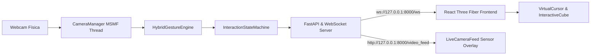

# Architecture & System Design — VisionControl

## 1. Visão Geral da Arquitetura

O **VisionControl** é uma aplicação de interação gestual em tempo real onde a inferência de visão computacional é processada localmente em Python e transmitida via WebSocket de baixa latência para uma interface tridimensional em React Three Fiber.

---

## 2. Componentes do Backend
- **`CameraManager` (`visioncontrol/backend/camera/manager.py`):**
  - Captura assíncrona desacoplada usando backend nativo do Windows `CAP_MSMF`.
  - Buffer de vídeo de 1 frame em thread dedicada, eliminando bloqueio de I/O e garantindo 30 FPS contínuos.
- **`HybridGestureEngine` (`visioncontrol/backend/gestures/engine.py`):**
  - Carregamento do modelo MediaPipe `gesture_recognizer.task` via buffer binário de memória.
  - Fusão com o `GeometryClassifier` para desempate instantâneo e alta tolerância a rotações e variações de iluminação.
- **`InteractionStateMachine` (`visioncontrol/backend/tracking/state_machine.py`):**
  - Estados: `IDLE`, `TRACKING`, `HOVERING`, `DRAGGING`, `LOST_TRACKING`.
  - Suavização do cursor via Filtro 1€ adaptativo.
  - Histerese temporal de 3 frames para evitar trepidação em comandos rápidos.
- **`Stream MJPEG` (`/video_feed`):**
  - Anotação dos 21 landmarks da mão, conexões anatômicas e telemetria diretamente sobre a imagem da câmera.

---

## 3. Componentes do Frontend
- **`SceneContainer` (`visioncontrol/frontend/src/scene/SceneContainer.tsx`):**
  - Renderiza o cubo interativo central e grid tecnológico.
  - Realiza raycasting com a coordenada normalizada do cursor.
  - Arraste projetado sobre plano virtual Z=0 com interpolação `lerp`.
- **`LiveCameraFeed` (`visioncontrol/frontend/src/components/LiveCameraFeed.tsx`):**
  - Janela flutuante no canto inferior exibindo a imagem real da webcam com os sensores desenhados.
  - Suporte a minimizar e ocultar/exibir.
- **`VirtualCursor` (`visioncontrol/frontend/src/components/VirtualCursor.tsx`):**
  - Cursor HUD responsivo com indicação de estado e feedback de cor.
